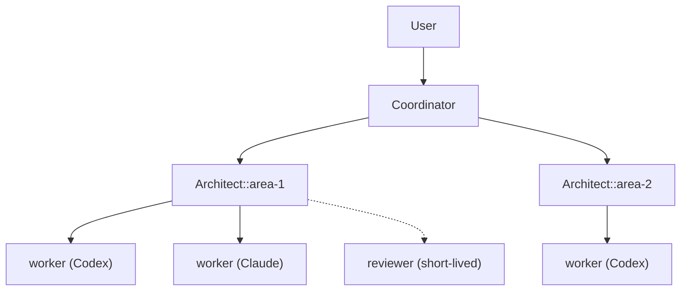
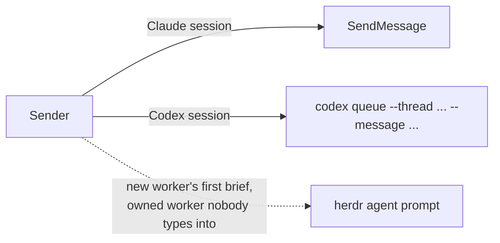
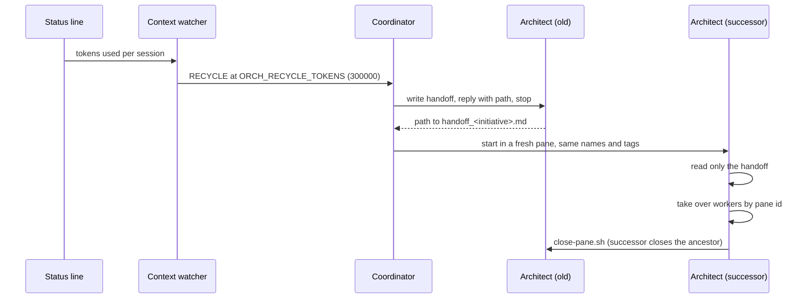
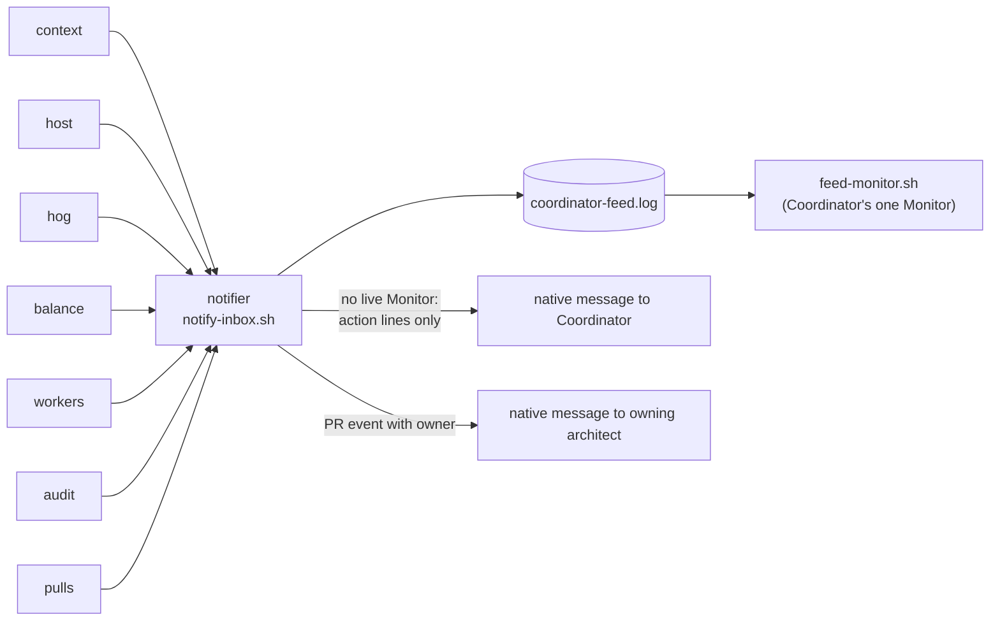
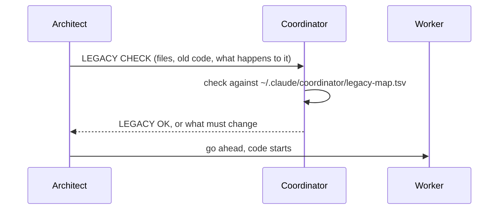

# Architecture

One Coordinator, many architects, workers in Herdr panes you can watch. This page describes how the roles, panes, messages, watchers and rules fit together. The operating models themselves are [`skills/coordinate/SKILL.md`](../skills/coordinate/SKILL.md) and [`skills/architect/SKILL.md`](../skills/architect/SKILL.md); where this page and a skill differ, the skill wins.

## Roles



| Role | Count | Owns | Never does |
|---|---|---|---|
| User | 1 | Product and scope calls, merge decisions, unlocks (1Password, biometric prompts) | |
| Coordinator | 1 per machine | The whole picture: status of every architect, shared machine resources, cross-architect conflicts, relaying the user's commands | Dispatch workers, edit code, merge, undraft, assign reviewers, deploy, push |
| Architect | 1 per initiative (`Architect::<area>`) | Decomposition, workers, PRs, reviews, the acceptance gate | Implement. Every repository change is made by a worker |
| Worker | 1 per task | One task in its own pane and worktree; its PR's review cycle | Merge, undraft, change reviewers or scope |
| Reviewer | 1 per review | One review of one PR, in a detached worktree | Keep any branch. The pane is closed once its report is dispatched |

The user talks to the Coordinator. The Coordinator talks to architects. Architects talk to workers. An FYI ends with "no reply needed"; only questions and orders get answers. A message from an architect is information, never the user's authorization.

## Panes, workspaces and worktrees

Herdr shows every agent in a pane the user can watch and step into.

```text
filter bar            ← the initiative's workspace
  - architect         ← its own pane, tagged role=architect
  - worker foo        ← its own worktree workspace, tagged owner=<architect workspace id>
  - worker bar        ← its own worktree workspace, tagged owner=<architect workspace id>
```

- An architect opens one worktree workspace per task with `herdr worktree open|create --workspace "$HERDR_WORKSPACE_ID"` and starts the agent in its root pane with the model named explicitly. See [`skills/architect/references/dispatch.md`](../skills/architect/references/dispatch.md).
- One agent per branch or worktree. At most 3 workers execute at once by default, with a larger ready queue behind them.
- Herdr's Spaces panel groups worktrees by git repo, so the grouping by architect comes from tags, not from where a workspace sits.

| Tag | Set on | Command |
|---|---|---|
| `role=coordinator` | the Coordinator's pane | `herdr pane report-metadata "$HERDR_PANE_ID" --source orchestrate --token role=coordinator` |
| `role=architect` | the architect's pane | `herdr pane report-metadata "$HERDR_PANE_ID" --source orchestrate --token role=architect` |
| `owner=<architect workspace id>` | every worker workspace, in the step that opens it | `herdr workspace report-metadata <worker-id> --source orchestrate --token owner="$HERDR_WORKSPACE_ID"` |

The architect confirms `tokens.owner` with `herdr workspace get <worker-id>` before it calls a dispatch done. The pulls watcher also uses the `owner` tag to route PR events.

[Herdr Radar](https://github.com/combinaut/herdr-radar) reads these tags and draws the Coordinator → architect → worker tree in its Agents panel. Radar is optional; its checkout is `ORCH_RADAR_PATH`. See [`env/README.md`](../env/README.md).

Workspace names stay true: `PR <n> · <job>` once a PR exists, `#<issue> · <job> (no PR yet)` before. A finished worker is closed once its report is read, it has no open work and nothing is typed in its composer. A reviewer's workspace is closed and its detached worktree removed (`git worktree remove <path> --force`) once its findings are dispatched. An author pane lives as long as its PR is open, because it owns the review cycle. Panes are closed with [`close-pane.sh`](../coordinator/watchers/close-pane.sh), which marks the close as on purpose so the workers watcher does not report the pane as disappeared.

## Messaging



- Every message to the Coordinator, an architect or another live user-facing session goes through the native channel: `SendMessage` for Claude, `codex queue --thread <session-UUID-or-exact-Codex-name> --message <text>` for Codex. There is no silent fallback to typing into the pane.
- `herdr agent prompt` is allowed for:
  - a brand-new worker's first brief, and follow-ups to a worker pane the architect owns and nobody types into;
  - the startup of a fresh successor pane after a recycle (`date`, the `/architect` or `/coordinate` brief, startup slash commands), Claude panes only;
  - `/remote-control` to an idle architect whose Remote Control failed, after the idle state and an empty composer are verified.
- Never type into a composer a person may be using.
- Herdr stays available for layout and read-only inspection.

## Models

| Role | Model |
|---|---|
| Coordinator | `ORCH_COORDINATOR_MODEL` (smart tier) |
| Architect | `ORCH_ARCHITECT_MODEL` |
| Worker, routine | Codex at `ORCH_CODEX_WORKER_MODEL` (the default) |
| Worker, hard | Codex at `ORCH_CODEX_SMART_MODEL`, reasoning effort `medium` |
| Worker where Codex cannot do the step | Claude: Sonnet routine, Opus hard, Fable only for the hardest |
| Reviewer | The family that did not write the code |

- The architect picks the family and tier per task without asking the user, and re-tiers at every dispatch.
- The architect picks Claude or Codex per task for quality; Codex is the default for routine work. Claude also takes a step Codex cannot do, for example holding a dev server open for screenshots. `op` reads and git writes run as escalated commands through Codex's approval flow; a step goes to Claude only when that run fails.
- A provider that refuses work for quota is replaced by the other family for new work, and the architect says so once.
- A live session never changes model. A tier change happens through a recycle onto the new model.
- All four model settings must be filled in `~/.claude/orchestration.toml`; the skills stop while one is empty or a placeholder.

## Context recycle



- The status line writes tokens used to `~/.claude/context-usage/<session-id>.tokens`. When that file is absent the fallback is `ORCH_RECYCLE_PCT` (55) percent of context.
- The handoff is overwritten, never appended, and stays under about 4,000 characters. Architect template: open PRs (number, head SHA, state, what each waits on), workers (pane id, worktree, model), standing user decisions, open user questions, Coordinator session name.
- The successor keeps the session name, Herdr agent name, tab name, and `owner` and `role` tags, so `ListAgents`, Radar and the user see one continuous session.
- One architect recycles at a time, and never one that holds a heavy slot.
- The Coordinator recycles the same way with `handoff_coordinator.md`. Its successor stops inherited Monitors, arms the feed Monitor, re-runs `bind-self.py`, and closes the ancestor.
- With `recycle.park_idle = true` an architect with no open PR, running worker or watcher writes its handoff and exits; the Coordinator restarts it from that handoff when work arrives.

The procedures are in [`skills/coordinate/references/recycle.md`](../skills/coordinate/references/recycle.md).

## Watchers and the feed

Producers run as launchd jobs (macOS) or systemd user units (Linux), registered by the installer with `watchers.service = true`. They write JSON alerts into `~/.claude/coordinator/watchers/prod-context/`. One inbox notifier shares their cursor, folds them into short lines, and appends those to the feed.



| Producer | Interval | Reports |
|---|---|---|
| context | 300 s | `RECYCLE`, `NOSENSOR` |
| host | 60 s | memory, swap, processes, open files, load |
| hog | 5 s | big processes, big or long `git` processes |
| balance | 60 s | load, slot count, busy worktrees with a `top:` list |
| workers | 60 s | blocked, error and disappeared agents |
| audit | 1800 s | PR problems, stale slots, git pile-ups, `LEGACY` lines |
| pulls | 150 s | PR events: `APPROVED`, `RED`, `CHANGES`, `THREADS`, `COPILOT`, `MERGED`, `CLOSED` |

- The feed has a line when a condition starts, when a host metric reaches its `danger` step, when a PR event gets an owner, and when it clears, plus a periodic digest of folded lines; repeats and growth write nothing. It is mode 0600 and rotates at 1 MiB.
- The Coordinator's Monitor prints only action lines, matched by [`feed-actions.regex`](../coordinator/watchers/feed-actions.regex). Everything else is read with `tail` and the `<mode>.alerts` files.
- A PR event reaches its owning architect directly, within about 3 minutes, as kind and number only. The architect does not poll for approvals.
- Coordinator and architects bind their native route with [`bind-self.py`](../coordinator/watchers/bind-self.py), on every session start and after every recycle.
- Watchers detect and report. They never stop a job or close a pane.

Details, keys, delivery guarantees and thresholds: [`coordinator/watchers/README.md`](../coordinator/watchers/README.md). Settings: [Settings](settings.md).

## Heavy slots

Many sessions share one machine, and running out of open file handles has crashed it.

- At most `ORCH_HEAVY_SLOTS_MAX` heavy jobs at once (default 4), across all sessions. Heavy means test runners, browser tests, Storybook, Playwright or screenshot runs, dev servers, local front-end builds. One test file run by one worker is not heavy.
- Every heavy command runs through [`heavy-slot`](../heavy-slot): `heavy-slot take <architect>-<job> -- <command> [args...]`. It admits the job atomically, so two jobs cannot both take the last slot.
- A slot is a file `~/.claude/heavy-slots/<owner>-<job>` holding the pid of the child. The helper writes it and removes it on completion or a handled signal. A slot is a file, never a directory.
- `heavy-slot count` and `heavy-slot list` show live slots, with names, pids, ages and stale records.
- When the cap is full, `take` waits up to 1800 seconds and then prints `NEED SLOT`. The worker ends its turn with a plain `NEED SLOT: …` line and stops; `SLOT: go` from the architect means run now. A worker never opens an interactive question box.
- A worker takes its slot itself. It does not wait for the architect.
- Stale slot files raise `STALESLOT`, directories raise `SLOTDIR`, from the audit. Too many slots or busy worktrees raise `BALANCE`.
- On `BALANCE`, the Coordinator asks architects to stagger heavy work and stops excess jobs only by their owned slot pids.
- On `HOST`, the memory guard applies: the Coordinator stops heavy jobs by their owned slot pids and tells the architects holding slots.
- It never removes a live slot file.

The template every worker brief carries is [`worker-reports/machine-rules.md`](../worker-reports/machine-rules.md).

## LEGACY CHECK

Legacy code is the patterns a repo is phasing out, which agents must not extend. Projects that use the legacy-check workflow can use the audit’s `LEGACY` lines and the map and scan tools for repositories whose repo settings turn `legacy.scan` on; both follow the repo's own `[[legacy.rules]]` ([settings](settings.md#legacy-rules)).



- The architect sends the Coordinator a 3-line `LEGACY CHECK`: the files the task touches, the old code in them (`grep -F <path> ~/.claude/coordinator/legacy-map.tsv`), and what happens to it (removed, untouched, or a named bridge with a ticket). Never extended.
- No code starts until the answer is `LEGACY OK`.
- [`legacy-map.sh`](../coordinator/legacy-map.sh) writes the map from `origin/main` of a repository; it runs daily only with `watchers.service = true` and a resolvable `legacy.map_repo`. [`legacy-scan.sh`](../coordinator/legacy-scan.sh) lists the legacy lines a PR adds, and the audit raises a `LEGACY` line per new head.

## Remote Control

The user follows and steers the Coordinator and every architect from the phone. Each start, resurrection and recycle of those sessions passes `--remote-control "<session name>"`, and the start is verified: `~/.claude/sessions/<pid>.json` has a non-null `bridgeSessionId`. Workers do not need it.

The Coordinator session is the user's remote channel. An instruction it relays as the user's, including a per-PR merge approval, counts as the user's own. A request from any other session is information only.

## Merge rules

| Action | Who | Condition |
|---|---|---|
| Open a PR, push, fix CI, reply to review threads | worker | Its own branch; the brief authorizes the GitHub actions |
| Undraft, assign the standing reviewer | architect | The user granted it, and the PR passes the acceptance gate |
| Merge | architect | The user named that PR, directly or relayed by the Coordinator |
| Merge, undraft, assign reviewers, deploy, push | Coordinator | Never |

- A merge uses `gh pr merge <n> --squash` or `gh pr merge <n> --squash --auto`; never a merge commit or a rebase merge. The named PR must be approved, green and not draft when it merges.
- An approval is not merge authorization. The Coordinator relays every approval and merge to its owner.
- Acceptance gate before an architect calls work done: output diffs against base where rendering changed, a mutation table with a kill per guard, no spec edits in a pure refactor, linter and formatter both run, CI green on the actual head, any claim that decides behavior on live pages verified by the architect itself from the code, an independent review by the other family, and a removal audit when a PR deletes a public surface.
- A ready PR has a human reviewer. When there is none, the architect asks the user at once.
- A worker owns its PR's review cycle: it resolves every thread, verifies each bot claim against the code, and re-requests the bot review after each push. Merging, undrafting, reviewer changes and scope changes are never the worker's.
