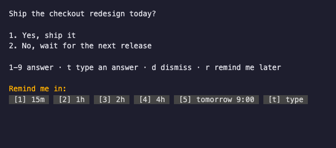

# User questions

Every user question opens below the asking architect’s own pane without taking focus. The opener validates `HERDR_PANE_ID` against the live pane list and splits that pane in its workspace. With no caller pane, or one that has disappeared, it falls back to the last `Q: ` pane, then the `To-do` label or `todo` token.



## Open and close

Create the question's Markdown file under `~/.claude/coordinator/questions/<slug>.md`, then run `ask-user-question <slug> <file>`. The pane is labelled `Q: <slug>`. The architect opens it directly and registers `QUESTION <slug> <file>` with the Coordinator for answer relay; the Coordinator records the slug’s asker rather than inferring it from the question pane’s location. Keep the matching wait in the architect’s status file so it also appears in the generated to-do list.

The question is rendered by the Rust Markdown viewer `mdcat`, found on `PATH` or at `/opt/homebrew/bin/mdcat`. Successful renders are cached by question text and terminal width. If the viewer is unavailable or fails, the panel shows plain text with one stderr warning and uses plain text for the rest of that panel’s lifetime. The answer controls stay interactive. C0/C1 controls other than newline and tab are stripped from question text and option labels before display; worker escalations strip them before writing the question file.

| Command | Effect |
| --- | --- |
| `ask-user-question <slug> <file>` | Opens the pane. |
| `ask-user-question close <slug>` | Finds the pane by its exact label, closes it through `close-pane.sh`, then removes the question's files. A failed close keeps the files for retry. |
| `ask-user-question hide <slug>` | Closes the pane and keeps the question files; the Q panel's Remind runs it. |

## Keys

| Key | Action |
| --- | --- |
| `1`-`9` | Picks that option id when the file has a `## Options` section, or records the number alone otherwise. |
| `t` | Type an answer; Enter sends it. |
| `d` | Dismiss: writes `answers: DISMISSED <slug>` to the feed, then closes the pane and removes the question. |
| `r` | Remind: opens the same picker as the to-do view's Reminder (`1` 15m, `2` 1h, `3` 2h, `4` 4h, `5` tomorrow 9:00, `t` a typed `30m` or `3h`). Esc cancels it. |

The panel writes `<slug>.answer`. `coord-user-answers-watch.sh` runs the answers watcher, which claims the file, normalises whitespace and publishes `answers: ANSWER <slug>: <text>` to the shared feed Monitor. The Coordinator relays `<slug>: <text>` to the registered asker verbatim. Worker choices use literal escaped markers and hard breaks to preserve their source ids, including gaps, while keeping the legacy bare-number answer format. Worker `signal-*` questions additionally bridge into the worker signal answer file so the original waiting `orch-signal ask` receives the answer by its stored identity.

## File format

The asker writes `~/.claude/coordinator/questions/<slug>.md`; the panel shows it unchanged:

```markdown
# <the question, one line>

<optional short context, Markdown>

## Options

1. <label>
2. <label>
```

The option id is the digit `1`-`9`, consecutive from `1`; the label is the rest of that one line after `<digit>. `. Duplicate ids are allowed: the last one wins. The renderer escapes option markers and preserves their line breaks so mdcat shows the source ids without renumbering them. An empty label is allowed. The label is whitespace-normalised (leading and trailing whitespace stripped, inner runs collapsed to one space) to match the answers watcher's own collapse.

- With a `## Options` section, key `1`-`9` records `ANSWER <slug>: <id> "<label>"`. A digit with no option records nothing and shows a short status line.
- In that answer line the label is everything between the first double quote after the id and the last double quote of the line, so a parser uses `^([1-9]) "(.*)"$`.
- Key `t` records `ANSWER <slug>: <text>`.
- Without a `## Options` section, key `1`-`9` records the digit alone.

## Remind

A pick writes `answers: REMIND <slug> <YYYY-MM-DD HH:MM>` to the feed and stores the time (epoch seconds) in `<slug>.remind` next to the question. The pane then runs `ask-user-question hide <slug>`. On its next cycle after that time, the answers watcher reopens the pane and removes the file. The opener records a live caller in `<slug>.asker-pane`; the watcher supplies that pane as `HERDR_PANE_ID` when reopening, with the same fallback if it has disappeared; the stale saved pane file is then removed. A reminder without saved metadata clears the watcher’s caller pane and uses the legacy fallback. Close removes this metadata; hide keeps it. A failed open retries on the next cycle. If the feed cannot be written, nothing changes and the panel stays open.

See [watchers.md](watchers.md) for how the answers watcher claims and publishes answers.
