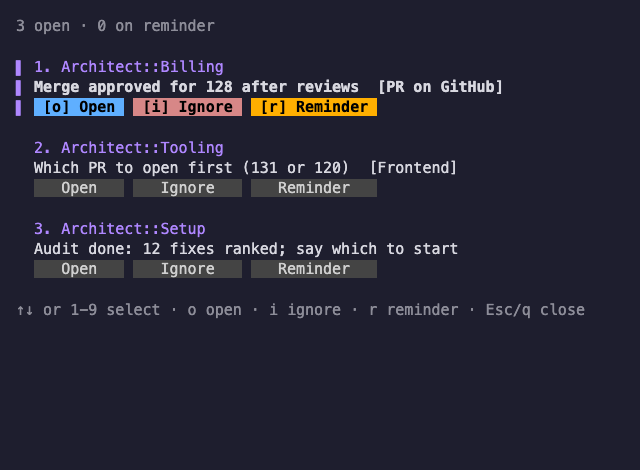

# The to-do pane

Architects keep a `## Waits on the user` list in `~/.claude/coordinator/status/<architect>.md`. The user-todo watcher merges those lists into `~/.claude/coordinator/user-todo.md`. To show it in a pane:

```bash
python3 ~/.claude/coordinator/user-todo.py --follow
```

`user-todo.py` without `--follow` writes the file once. In the pane, press a number then Enter (or click) to jump to the item. `n` and `p` change page. A jump removes the item from the list. An empty list reads `Nothing waits on you.`

For buttons instead, run `python3 ~/.claude/coordinator/user-todo-view.py` (`--demo` shows sample items). Clicking an item's architect heading or pressing Enter on its selected item focuses that architect's pane. Each item has Ignore and Reminder buttons (click, or `i` `r` on the selected item; `↑↓` or a number selects). Ignore removes the item for good: it returns only when the architect writes a new or changed item, and one `todo: TODO IGNORED <architect>: <text> (start)` line goes to the feed so the Coordinator can tell that architect. Reminder asks when (`1`-`5` for 15m, 1h, 2h, 4h, tomorrow 9:00; `t` types `30m` or `3h`) and hides the item until then; reminders are listed under `s` and come back marked `reminder:`; on a reminder item the button reads Cancel reminder. The top line reads `<n> open · <m> on reminder`. The `[s]` toggle and the `s show reminders` footer hint appear only while at least one reminder exists; the list closes when the last one goes. State is in `~/.claude/coordinator/user-todo-state.json` (not the generator's `user-todo.state.json`).

To open it as a Herdr popup on `prefix+t`, pass `--popup` so `Esc` or `q` closes it (the footer then shows `Esc/q close`; Herdr sets no popup marker). Without the flag nothing closes it, so the Coordinator's to-do pane stays up. `Esc` while the reminder choices show only cancels them, and `q` is typed as text in the `t` entry.

```toml
[[keys.command]]
key = "prefix+t"
type = "popup"
command = "python3 ~/.claude/coordinator/user-todo-view.py --popup"
description = "to-do list"
width = "80%"
height = "80%"
```

The Coordinator opens this view itself at start, in a pane labelled `To-do` beside its own (`~/.claude/coordinator/todo-pane.sh`). A pane with that label is kept, so a recycled Coordinator opens no second one. It runs without `--popup`, so nothing closes it.



`install.sh` (herdr env) also makes `prefix+t` open the buttons view as a popup titled "Your to-do". It links the Herdr plugin in `env/herdr/todo-plugin` and adds a marked `[[keys.command]]` block to Herdr's `config.toml`. To turn the popup off, set `todo_popup = false` under `[herdr]` in `~/.claude/orchestration.toml` and run `install.sh`; that removes both. See [docs/settings.md](settings.md).

Question panes (`ask-user-question`) stack below the pane labelled `To-do`.

## Answer an item

Architects can add consecutive numbered choices, from 1 to 9, before the target:

```markdown
## Waits on the user
- Deploy the release? [1: deploy now] [2: wait until tomorrow] -> Architect::Tooling
```

Select that item with the existing number keys or arrows in the buttons view,
then press **a** (or click **Answer**). In answer mode, press its choice number,
or **t** to type a free-text answer and **Enter** to send. **Esc** cancels the
answer; in a popup it stays open. The simple `user-todo.py --follow` list also
supports `a`: type the item number, press `a`, then choose or type. Outside answer
mode, number/Enter jumps, n/p paging, mouse clicks, Ignore and Reminder keep their
existing behavior. In text mode, letters such as q, n and p are answer text. If the item disappears or changes while you type, press Esc to leave the canceled answer; buffered text cannot act on another item.

The buttons view submits an answer synchronously from your choice click/key press or
Enter in the answer editor, as typed input to the owning architect's pane:
`Mario (to-do panel): <item text> -> <chosen answer>`. Both parts have controls
removed, whitespace collapsed, and a 512-character cap. Long item text keeps its
start and end with the middle elided. The status-file stem
selects the architect using its role/name and title; the `->` target still
controls ordinary jumps. Workers, the Coordinator, unknown owners and ambiguous
matches never receive typed answers.

The view reads the architect identity, status and visible Claude screen before
acquiring the answer locks. It requires idle, done or working status and a bare
`❯` prompt line immediately above the last pure horizontal border. The upper
border may contain a title; anything below the lower border is footer or status
text. A nonbreaking space after the prompt glyph counts as whitespace. An
unrecognized screen cannot establish emptiness.

Under the queue and item-state locks, the handler rechecks the item's generation,
existing delivery records, and that the snapshot is at most 250 ms old. A stale
snapshot, non-empty or uncertain composer, or blocked/unknown status keeps the
item. After releasing the locks, the view focuses the resolved architect and
shows `type it in the pane: <answer>`. Unknown or ambiguous owners receive no
focus. Only the prompt subprocess runs under the locks, serializing dispatch and
bookkeeping across views; reads and focus never wait on Herdr under either lock.
The screen check is a snapshot, so changes after it remain a terminal-input race.

A successful submission removes the item and shows `sent to <architect>`, adding
`(queued while busy)` for a working architect. Claude Code queues that typed
input. Only a documented pre-send rejection (`agent_blocked`) uses the queue/native relay and shows
`relayed; the architect may ask again`. A prompt timeout, other non-zero exit, or process-start error leaves delivery
unknown. The view records unknown delivery before dispatch, so an interrupted
submission also keeps the item and cannot become a duplicate native relay. It
suppresses automatic relay and repeat pane
submission, and shows `delivery unknown; check the pane: <answer>`. A later attempt reports the original stored
answer, even when you choose a different option. Check the architect's pane before
responding manually. The unknown-delivery record expires
after the retention window or when the status item changes. The simple `user-todo.py --follow` editor
continues to use that relay. Only the view's key/click handler requests pane input. Keys sent to the view's
pane by another process count as its input, just like typed keys. CLI flags,
environment variables, files and feed events have no direct pane-send path.

Successful typed submissions are recorded as delivered. The watcher still emits
`TODO ANSWER` for the Coordinator, while the notifier suppresses the architect's
native relay, including stale outbox copies. The watcher never types into panes.
Queued fallbacks retain the existing native binding and notifier retries. The
item returns when the architect changes or re-adds it; Ignore still emits
`TODO IGNORED` instead.

| Resource | Bound |
|---|---|
| Choices | Consecutive 1–9; each label at most 512 characters |
| Answer text | 1–512 characters; editor buffer stops at 512; typed item context also capped at 512 |
| Typing preview | Last four wrapped lines; the full answer is retained |
| Pending answers | One per item, at most 200 records machine-wide |
| Queue retention | Undelivered answers persist until native delivery or status-item change; delivered duplicate tombstones expire after 3600 seconds |
| UI lock wait | At most 2 seconds for the existing answers lock |
| Native delivery | Existing 200-entry outbox, 60-second retries, 3600-second expiry |

Runtime queue records live under `~/.claude/coordinator/todo-answers/`. Accepted
delivered records are retained for the retention window to prevent a second stale view
from submitting the same item again. The ordinary dismissal state preserves
removal after that window. No choices means no new buttons or answer mode.

Undelivered answers retry through the same notifier after its outbox retention window.
A status-item change includes a new `first_seen` generation when an identical line
is removed and re-added. Pruning compares the saved generation with the existing
to-do state and preserves records when that state is unreadable.
Dropping an undelivered answer after a status-item change also removes its dismissal
and emits one `TODO READFAIL answer discarded:` notice with the affected item and answer.
Pending discard notices share the existing 200-record queue cap and leave the queue on collection.
Unavailable status files retain the answer. The legacy answer editor ignores whole CSI
key sequences, including arrows, so they cannot cancel or insert text into an answer.
Incomplete CSI sequences stay buffered across reads, including modifier sequences
split after `ESC[1;`.

Each answer editor captures the item's `first_seen` generation when it opens. Submit
validates that captured generation, records the answer, and dismisses the item while
holding the queue and to-do state locks (queue first). If an identical wait was
removed and re-added, it rejects the stale answer with one visible error line and
leaves the replacement decision visible. Escape and reopen Answer to respond to it.

A complete Escape cancels answer mode before the next key in the same terminal read
is processed. A trailing incomplete Escape still waits for its existing timeout,
so split control sequences retain their normal handling.
